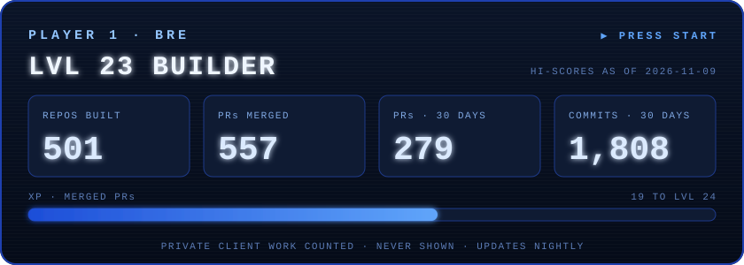

# hi, I'm Bre 👋

**I build AI agents, automations and the websites around them, and I ship daily.**

Bring me an idea or a problem and I'll figure it out: build it, wire it up, and hand you the keys.
I run [Local AI](https://localai.systems) from Ocean Isle Beach, NC. My portfolio is a search engine, because why not: **[bre.lol](https://bre.lol)**.

Most of what I build is private client work. The scoreboard counts it every night without showing any of it.

---

### 🏆 Achievements unlocked

Every achievement links to its proof.

| | Achievement | Proof |
| --- | --- | --- |
| 🟢 | **Green Wall** · 52 of 52 tests passing on an agent sandbox: what actually restricts a spawned coding agent (and why `--allowed-tools` doesn't), an atomic task queue, prompt-injection fencing | [claude-agent-sandbox](https://github.com/brebuilds/claude-agent-sandbox) |
| 💯 | **Century Club** · the ClickUp API as 101 MCP tools with uniform auth, errors and pagination. CI on every push | [mcp-clickup-bre](https://github.com/brebuilds/mcp-clickup-bre) |
| 🔑 | **Keymaster** · MCP server for the Etsy API with OAuth2 PKCE, token refresh and multiple shops | [etsy-mcp](https://github.com/brebuilds/etsy-mcp) |
| 🙈 | **Never Saw the Token** · Eagle asset manager turned print-on-demand asset store, plus an MCP that lets an agent use it without ever seeing the token | [eagle-bridge](https://github.com/brebuilds/eagle-bridge) · [eagle-mcp](https://github.com/brebuilds/eagle-mcp) |
| 🛠️ | **Agent-Ready** · non-personal versions of tools I actually run. Each ships a CLI *and* a `SKILL.md` so an agent can run it too | [useful-automations](https://github.com/brebuilds/useful-automations) |
| 🧠 | **Orchestrator** · Claude Code skills for multi-subagent orchestration with context isolation, knowledge-graph extraction and API integration patterns | [claude-skills](https://github.com/brebuilds/claude-skills) |
| 🏝️ | **Island Architect** · a walkable Ocean Isle Beach in hand-written Three.js: locals with dialog, a discovery journal, day into night | [play it](https://oib-game.vercel.app) · [code](https://github.com/brebuilds/oib-game) |
| 🤖 | **Not a Robot** · one "I'm not a robot" checkbox, then an endless run of challenges that slowly lose their minds | [play it](https://endless-captcha.vercel.app) · [code](https://github.com/brebuilds/endless-captcha) |
| 🎹 | **Air Pianist** · a VST3 plugin in JUCE/C++ that turns hand position into MIDI, so you can play any synth in the air | [theremin-vst](https://github.com/brebuilds/theremin-vst) |
| 🔎 | **Feeling Lucky** · my portfolio as a Google-style search page; "can bre…" autocomplete answers with real work | [bre.lol](https://bre.lol) |

### 🔒 Locked

| | Quest | Status |
| --- | --- | --- |
| 🔒 | **365** · one AI tool or automation built in public every day for a year | in progress |

### What I build with

Next.js · TypeScript · Python · Three.js · Claude Code & MCP · n8n · Airtable · Notion · Sanity · Shopify · Vercel
